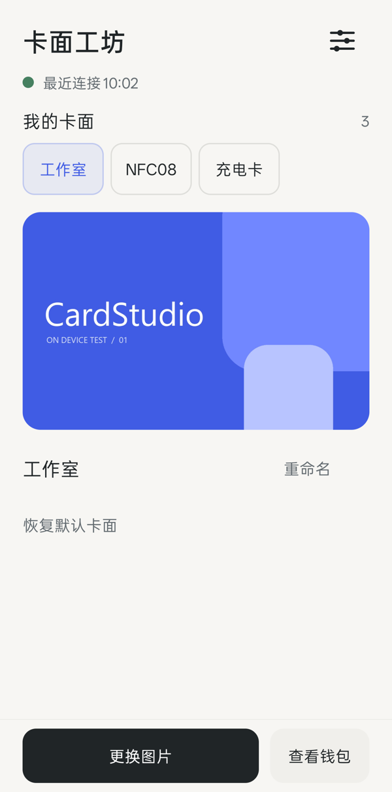
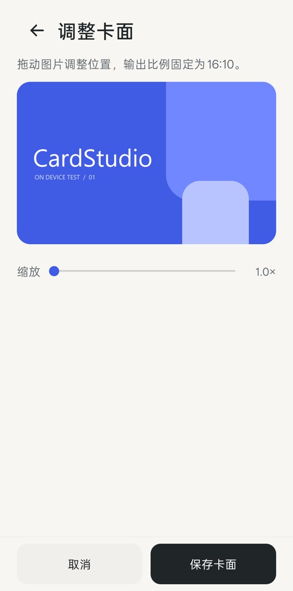

# 卡面工坊 · CardStudio

为一加／OPPO 钱包更换自己的 NFC 卡面。一个免费的、独立实现的 LSPosed 模块。

**状态：0.1.0-alpha01，实验版。** 已在一加 13T、Android 17 / ColorOS 17、钱包 5.50.9 上完成图片替换和恢复原图验证。尚不承诺其他机型、钱包版本或系统版本兼容。

[下载实验版](https://github.com/TheSmallHanCat/CardStudio/releases) · [验证记录](docs/validation.md)

<p>
  
  
</p>

截图使用原创测试图，不包含用户照片。

## 功能

- 发现钱包实际加载的卡面，逐张配置图片。
- 系统图片选择器、16:10 裁剪、拖动与缩放、标题编辑。
- 关闭替换或恢复单张原图。
- 本地兼容性诊断：钱包版本、图片入口数量、最近连接、替换命中。
- 通过类和方法签名识别图片入口，避免固定依赖单个混淆方法名。

模块只影响钱包界面中的图片，不会复制实体卡、解密扇区或改变门禁权限。新录入的加密卡是否能刷门禁，仍取决于钱包录入结果和门禁系统。

## 使用

1. 安装 APK，在兼容 API 101 的 LSPosed 中启用「卡面工坊」，作用域选择 `com.finshell.wallet`。
2. 关闭其他修改钱包卡面的模块，重启钱包进程。首次启用可能需要重启手机。
3. 打开钱包，进入需要更换的门禁卡或交通卡页面。
4. 返回卡面工坊，选择发现的卡面，再选择图片、裁剪并保存。
5. 重新进入钱包卡片页查看结果。关闭主开关后重新进入卡片页，可恢复原图。

同一原始卡面可能被钱包的多张卡共用；基于图片来源的规则会一同替换这些卡的该张图片。

## 实现边界

当前只作用于钱包主进程和 NFC 展示进程的 `CircleNetworkImageView` 图片入口。替换必须精确命中配置中的来源：

- OPPO 两个公开卡面 CDN 的 HTTPS `/file/nfc/` 图片；
- 在 NFC 卡片控件中发现的钱包私有图片路径。

图片保存在模块自己的私有目录，通过只读 Provider 提供给钱包。Provider 验证调用 UID，仅接受本应用和 `com.finshell.wallet`。模块不申请网络、NFC、存储或 root 权限，不上传图片、卡号和日志。诊断复制不包含原始图片来源。

旧图片 revision 保留至少 24 小时，避免钱包异步加载时丢失文件；后续保存会限量清理过期版本。

## 构建

需要 JDK 17+、Android SDK Platform 36、Build Tools，以及已接受的 Android SDK 许可。

```bash
export JAVA_HOME="/path/to/jdk-17"
export ANDROID_HOME="/path/to/android-sdk"
./gradlew :app:testDebugUnitTest :app:assembleDebug :app:lintDebug
```

Windows 工程路径包含中文时，部分 Java 测试工具会无法加载测试类。可用隔离构建脚本：

```bash
python scripts/build.py --jdk "C:/path/to/jdk-17" --sdk "C:/path/to/android-sdk"
```

脚本在临时 ASCII 路径中构建源码快照，结果复制到 `dist/`。`local.properties`、签名密钥、私人图片、设备日志和构建产物均不进入仓库。

## 兼容性反馈

请提供手机型号、系统版本、钱包版本、LSPosed 版本及模块内「复制诊断」的内容。不要上传卡片 dump、NFC 密钥、卡号或个人卡面图片。

## 许可证与致谢

MIT。Xposed 接口使用 [libxposed API 101](https://github.com/libxposed/api)；框架由用户自行安装。仓库不包含第三方钱包 APK、旧 DIY 模块代码或用户图片。
